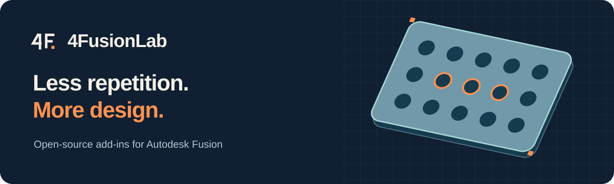

<h1 align="center">4FusionLab</h1>

<strong>Less repetition. More design.</strong> Independent Fusion 360 add-ins for CAD modeling, built to make everyday work in Autodesk Fusion easier.

<a href="#our-projects">Projects</a> · <a href="#coming-next">Coming next</a> · <a href="README.ru.md">Русский</a>

---

## Our projects

| Project | What it does | Status | Action |
| --- | --- | --- | --- |
| **[Perfora](https://github.com/4FusionLab/Perfora)** — Goddess of holes | Create perforation patterns, ventilation grilles, and decorative panels. | Stable | **[Download](https://github.com/4FusionLab/Perfora/releases/latest)** |
| **[Selectra](https://github.com/4FusionLab/Selectra)** — Goddess of choice | Find similar faces, edges, and connected contours. | Stable | **[Download](https://github.com/4FusionLab/Selectra/releases/latest)** |
| **[Ejix](https://github.com/4FusionLab/Ejix)** — Spirit of extraction | Extract selected volumes into separate bodies or components. | Stable | **[Download](https://github.com/4FusionLab/Ejix/releases/latest)** |
| **[RuEn](https://github.com/4FusionLab/RuEn)** — Hero of translation | Russian-layout keyboard shortcuts for Fusion on macOS and Windows. | Stable | **[Download](https://github.com/4FusionLab/RuEn/releases/latest)** |

### Made with Perfora

Explore more examples in <a href="https://github.com/4FusionLab/Perfora">Perfora</a>.

## Coming next

### [Planara](https://github.com/4FusionLab/Planara) — Goddess of flat worlds

A future Fusion add-in for turning selected surfaces of solid models into flat layouts.

**Status: Planned.** [View Project](https://github.com/4FusionLab/Planara). Not available for download yet.

## Why 4FusionLab?

We build focused, practical modeling tools. Each project has its own personality in the original **4FusionLab mythology**, together with documentation, release information, and a place to share feedback.

Have a suggestion or found an issue? Visit the [project repositories](https://github.com/orgs/4FusionLab/repositories) and open an issue in the relevant one.

Independent projects. Not affiliated with or endorsed by Autodesk. Licenses and compatibility are specified in each project repository.
