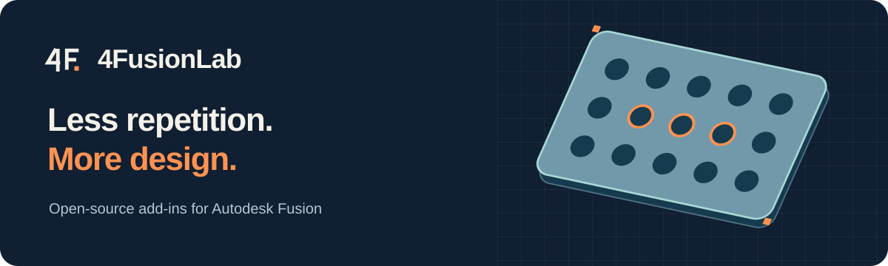

<h1 align="center">4FusionLab</h1>

<strong>Меньше рутины. Больше проектирования.</strong> Независимые инструменты для Autodesk Fusion, упрощающие повседневную работу с моделями.

<a href="README.md">English</a> · <a href="#наши-проекты">Проекты</a> · <a href="#скоро">Скоро</a>

---

## Наши проекты

| Проект | Назначение | Статус |
| --- | --- | --- |
| **[Perfora](https://github.com/4FusionLab/Perfora)** — богиня отверстий | Перфорация, вентиляционные решётки и декоративные узоры. | **[Скачать](https://github.com/4FusionLab/Perfora/releases/latest)** |
| **[Selectra](https://github.com/4FusionLab/Selectra)** — богиня выбора | Быстрое выделение похожих граней, рёбер и связанных контуров. | **[Скачать](https://github.com/4FusionLab/Selectra/releases/latest)** |
| **[Ejix](https://github.com/4FusionLab/Ejix)** — дух извлечения | Извлечение выбранных объёмов в отдельные тела или компоненты. | **[Релизы](https://github.com/4FusionLab/Ejix/releases/latest)** |
| **[RuEn](https://github.com/4FusionLab/RuEn)** — герой перевода | Языковой помощник для Fusion, ориентированный на macOS. | В разработке |

### Создано с Perfora

Больше примеров — в проекте <a href="https://github.com/4FusionLab/Perfora">Perfora</a>.

## Скоро

### [Planara](https://github.com/4FusionLab/Planara) — богиня плоских миров

Будущий аддон для Fusion, который поможет разворачивать выбранные поверхности твёрдых тел в плоские выкройки.

**Ранняя разработка. Пока не выпущен.**

## Почему 4FusionLab?

Мы создаём небольшие практичные инструменты, которые помогают сосредоточиться на моделировании, а не на повторяющихся действиях. У каждого проекта — свой персонаж в авторской мифологии **4FusionLab**, документация и отдельное место для обратной связи.

Есть идея или нашли ошибку? Откройте Issue в [соответствующем репозитории](https://github.com/orgs/4FusionLab/repositories).

---

Независимые проекты. Не связаны с Autodesk и не одобрены ею. Лицензии и совместимость указаны в репозиториях соответствующих инструментов.
